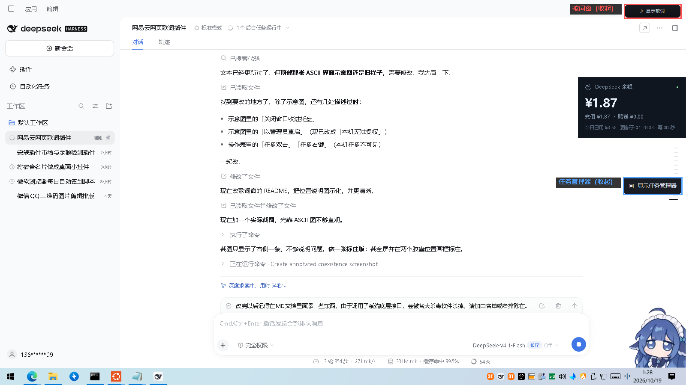

# 桌面歌词条

在网页版网易云音乐里放歌，**桌面顶部会挂着一条跟着滚动的歌词**，浏览器最小化也照常显示。

**不需要装浏览器扩展。** 歌词窗直接读 Windows 的系统媒体会话（就是按音量键弹出来的那个媒体卡片），
所以任何会向系统上报媒体的播放器都能用：网页版 Edge / Chrome、甚至网易云客户端。

## 怎么用

1. 双击 **`启动.cmd`**（会依次起本地服务、媒体会话桥、歌词窗）
2. 在你惯用的播放器里放歌，歌词窗自动跟上

就这样。想开机自启：

```powershell
powershell -ExecutionPolicy Bypass -File 安装开机自启.ps1 install
```

## 界面

```
● 歌名  歌手                                    ← 状态灯：红=播放中 黄=暂停 灰=没连上
        当前唱到的那一句（大字）
        下一句（灰字）
        翻译 / 罗马音（如果有）
─────────────── 1:43 / 5:26                     ← 进度条 + 时间
```

| 操作 | 效果 |
| --- | --- |
| 拖顶部细条 | 移动（只影响本次运行） |
| 双击 | 单行 / 双行 |
| 右键 | 菜单：显隐、单行双行、字号 20–34、重新取词、退出 |
| `Ctrl`+`Alt`+`L` | 显示 / 隐藏 |
| `Ctrl`+`Alt`+`C` | 单行 / 双行 |
| `Ctrl`+`Alt`+`Q` | 退出 |

**隐藏后怎么找回来**：隐藏时不会彻底消失，屏幕**右上角**会留一个窄条 **「♪ 显示歌词」** 的胶囊，
**点它**就展开；也可以按 `Ctrl`+`Alt`+`L`，或右键胶囊选「显示歌词」。

**空闲自动收起也会变成这个胶囊**，不会再缩成看不见的 1×1——之前那个行为会让窗口在
没有歌播放时彻底消失，而且只有"再次有歌在播"才恢复，等于把人锁在外面。

**关于系统托盘**：`.NET` 的 `NotifyIcon` 在某些 Windows 版本上不显示（实测本机
`Shell_TrayWnd` 下连 `ToolbarWindow32` 都没有，UIA 也读不到第三方图标）。
所以这里不把托盘当作唯一入口，**胶囊和热键才是主路径**。

## 杀毒软件可能报毒 / 拦截

**先用一句话说清它做什么**：在本地读取 Windows 的媒体会话（歌名/播放位置），
从网易云官方接口取歌词，然后画在屏幕上。**不采集、不上传任何数据。**

但它的实现方式会踩到安全软件的敏感点：

| 会触发误判的行为 | 为什么必须这么做 |
| --- | --- |
| 读系统媒体会话（`Windows.Media.Control`） | 这是拿到"播到第几秒"的唯一公开途径 |
| `SetWindowRgn` / `UpdateLayeredWindow` 等原生窗口 API | 置顶、透明、圆角靠这些 |
| `RegisterHotKey` 全局热键 | `Ctrl+Alt+L` 显隐 |
| 本地 HTTP 服务（`127.0.0.1:28123`） | 扩展/桥接程序往里报状态，**只监听本机，不对外** |
| PowerShell 脚本（`smtc-bridge.ps1`） | 读媒体会话，脚本内容全明文可读 |
| 无数字签名 | 个人项目，没有代码签名证书 |

**火绒、360 的主动防御**和 Defender 的启发式扫描可能：

- 拦截启动或弹窗询问
- **静默结束进程**（没有任何提示，歌词窗就是不见了）
- 直接删掉 `DesktopLyric.exe` / `smtc-bridge.ps1`

### 处理办法

1. 第一次运行时留意弹窗，选「允许」「信任」
2. 加白名单（把整个 `wyy-desktop` 目录加进去最省事）：
   - **火绒**：安全工具 → 信任区 → 添加目录
   - **360**：木马查杀 → 信任区
   - **Defender**：Windows 安全中心 → 病毒和威胁防护 → 排除项
3. **症状判断**：如果双击后窗口一闪就没、或者过几秒自己消失，多半是被杀了

### 自证清白

- `smtc-bridge.ps1` 是**纯 PowerShell 明文脚本**，可以用记事本打开逐行看
- `server.js` 是明文 Node 脚本，网络请求只发给 `music.163.com` 和 `c.y.qq.com`
- `DesktopLyric.exe` 由 `src/DesktopLyric.cs` 编译而来，可以自己编译（见下）

> 本地服务 `127.0.0.1:28123` 只绑在回环地址上，局域网里其它机器访问不到。

## 在屏幕上的位置



红框是**本程序**收起后的胶囊（右上角），蓝框是**极简任务管理器**收起后的小条（右侧中部）。
两个同时收起也不会互相遮挡。

```
┌────────────────────────────────────────────────┐
│              ┌──────────────────┐              │
│  ♪ 显示歌词  │   桌面歌词条      │  ← 顶部居中   │
│  （收起时）  │                  │    收起时在右上角│
│              └──────────────────┘              │
│                                                │
│          ┌────────────────────────┐            │
│          │   （极简任务管理器）     │            │
│          │                        │ ▣ 显示任务 │
│          └────────────────────────┘   管理器    │
│                                  ↑ 那个在右侧中部│
└────────────────────────────────────────────────┘
```

**和极简任务管理器共存**：如果同时装了 [mini-tasker](https://github.com/CSCBDD392/mini-tasker)，
两个收起的胶囊会互相避让——本程序在**右上角**，那个程序在**右侧中部**，实测互不遮挡。
主窗口也会互相避让：歌词条固定在顶部居中（宽 760），任务管理器从 y≥180 起。

胶囊落座时会**四角+中心各采样一次**，任一点被别的窗口压住就换个位置；桌面和任务栏算背景，
不算被占。

默认位置：屏幕顶部居中，760×148。没在播放超过 5 分钟会自动收成胶囊，一放歌就回来。

## 它是怎么知道"播到第几秒"的

这是整个东西的关键，也踩过坑，记在这里：

Windows 的系统媒体会话会给出 **歌名、歌手、播放状态、位置**。但有个特点——
**连续播放时"位置"和"更新时间"是冻住的**，只有在暂停、恢复、切歌、拖动进度条这些事件发生时才会刷一次。

所以做法是「锚定 + 外推」：

- 每次拿到一次刷新（换歌/暂停/恢复/拖动），就把「位置 + 当时时间」记成锚点
- 播放中，当前位置 = 锚点位置 + 已经流逝的时间
- 只在锚点真的变化时重新锚定，**绝不因为位置字段没动就重锚**（那会让歌词每两秒被打回原位）

这套逻辑在 `smtc-bridge.ps1` 里，文件顶部有注释。

## 文件

| 文件 | 作用 |
| --- | --- |
| `启动.cmd` | 一键启动：起服务 → 起媒体会话桥 → 开歌词窗（纯 ASCII，避免 cmd 中文乱码） |
| `smtc-bridge.ps1` | 读 Windows 媒体会话，做锚定/外推，把状态发给本地服务 |
| `server.js` | 本地服务：按歌名歌手搜歌曲 id → 取歌词（网易官方接口，失败退 QQ 音乐） |
| `DesktopLyric.exe` | 歌词窗本体（原生分层窗口，置顶 / 圆角 / 逐像素透明） |
| `src/DesktopLyric.cs` | 上面那个 exe 的源码 |
| `安装开机自启.ps1` | 注册 / 查看 / 移除登录自启 |
| `logs/` | 启动输出、桥接 PID |

## 编译

只有一个源文件，用 .NET Framework 自带的编译器就行，不需要装 Visual Studio：

```powershell
& "$env:WINDIR\Microsoft.NET\Framework64\v4.0.30319\csc.exe" /nologo /target:winexe /platform:anycpu /optimize+ `
  /out:"DesktopLyric.exe" `
  /reference:System.dll /reference:System.Drawing.dll /reference:System.Windows.Forms.dll /reference:System.Web.Extensions.dll `
  "src\DesktopLyric.cs"
```

如果你不放心下载 exe，直接跑这两行，得到的就是和仓库里一模一样的程序。

## 可选：装浏览器扩展

`..\wyy-lyric` 那个扩展仍然可以用，但它现在是**可选的**。
作用只有一个：提供精确的歌曲 ID，避免"按歌名搜 id"偶尔搜错。
装了的话，扩展上报的数据优先；没装也完全不影响使用。

## 排障

**歌词窗显示「网页版未连接」**
说明媒体会话桥没在上报。检查：

```powershell
# 服务在不在
curl http://127.0.0.1:28123/api/health

# 桥有没有在跑（看 logs\bridge.pid 里的进程）
Get-Process -Id (Get-Content .\logs\bridge.pid)
```

最省事的办法：关掉所有相关的窗口，重新双击一次 `启动.cmd`。

**放的歌有歌词，但这里显示「纯音乐，请欣赏」**
网易云这首歌的歌词本身就是「纯音乐，请欣赏」（纯音乐/无人声作品），不是取词失败。
比如 `南淮之长夜无荒` 就是。

**位置对不上 / 慢半拍**
先确认是不是同一个播放器有两个媒体会话（比如网页版和客户端同时开着）。桥会挑「正在播放」的那个；
如果两个都在放，就会挑错。把不用的那个停掉即可。

**想让它直接显示调试信息**

```powershell
# 单独跑桥，逐拍打印锚定决策
powershell -ExecutionPolicy Bypass -File .\smtc-bridge.ps1 -Verbose
```

## 已验证

- 媒体会话读取：歌名/歌手/播放状态/位置/总时长，实测可读
- 位置外推：连续采样，3 秒间隔收到 +3.02 秒，不回跳
- 暂停/恢复：SMTC 会刷新位置，锚点随之更新（实测暂停时位置从冻结值跳到 42.126s）
- 歌名 → 歌曲 id：`南淮之长夜无荒` 正确解析到 555181271，歌词状态「纯音乐」符合实际
- 一键启动：自动找 node、起服务、起桥、开窗，全链路 `connected=True source=smtc`
- 置顶：最大化记事本遮挡后歌词条仍在其上方
- 断连 5 分钟自动收起，重新播放自动恢复
